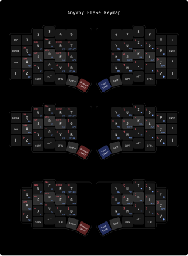

# Lever Flake Firmware

[ZMK Firmware](https://zmk.dev) configuration for the [Lever Flake](https://github.com/lever-tech/flake) keyboard.

## Documentation

- [Flashing Guide](./docs/flashing_guide.md)

## License

GPL-3.0. See [LICENSE](./LICENSE).
